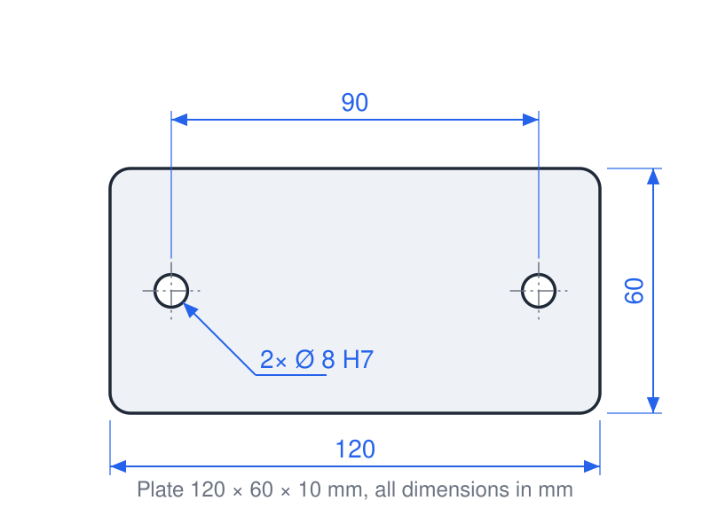
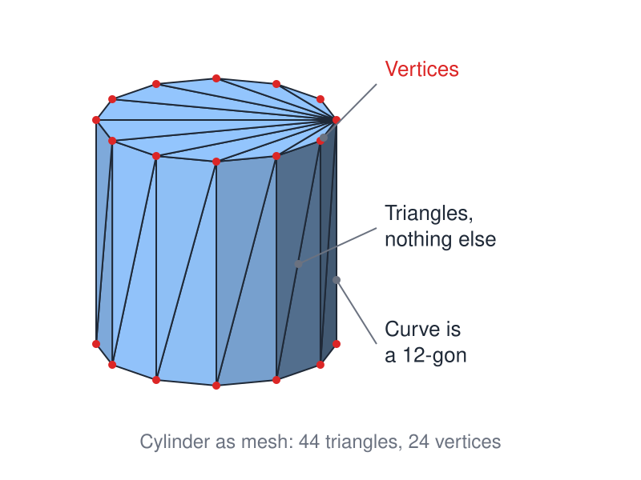
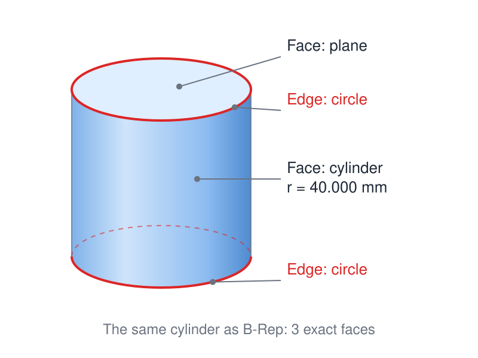
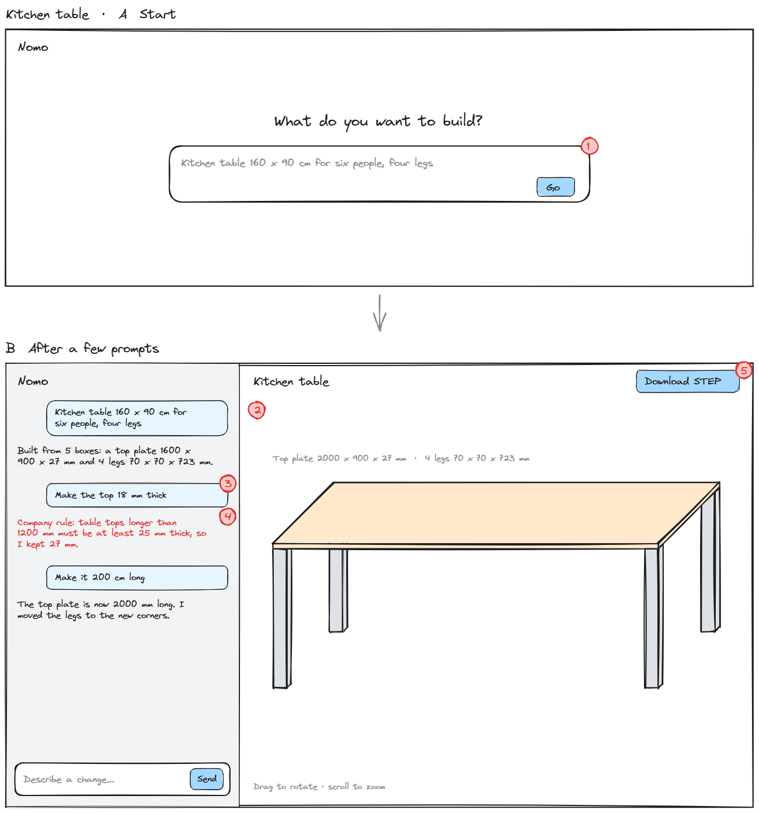

# Nomo

AI-generated CAD models to company standards

Team 1

Patrick Demichiel · Product Owner · October 2026

*nómos* (Greek): "law"

---



## What is CAD?

- **Computer-Aided Design**: engineers design parts that get manufactured
- Precision matters: dimensions, holes, tolerances
- e.g. SolidWorks, Siemens NX, CATIA
- 3D in games or Blender works differently

---

## Mesh and B-Rep

| Polygon mesh: games, Blender | B-Rep: CAD |
| --- | --- |
|  |  |
| Triangles only, curves approximated | Exact surfaces, edges and dimensions |

Like raster vs. vector graphics.

---

## The problem

- AI can already turn a text prompt into a CAD model
- But it draws **generic parts**, not the company's own, standard and purchased parts
- It doesn't know the company's **design rules**: wall thicknesses, hole spacing, bearing sizes
- An engineer has to check and fix every model, so the time saved is lost again

---

## How it works today

| Approach | Drawback |
| --- | --- |
| Model by hand | Slow, only for trained CAD experts |
| CAD configurators | Expensive to set up, can only do what was modelled in advance |
| Text-to-CAD (MecAgent, Zoo) | Fast, but knows neither company parts nor rules |

---

## Our idea

**The AI builds models mainly from templates instead of drawing free geometry.**

- A **template** is a parametric part with its own rules
- The AI chooses templates, sets parameters and positions them
- So models are made of company parts and follow company rules
- Where no template fits, the AI draws free geometry, marked as not company-standard

---

## Template example: box

```yaml
id: box
description: Cuboid, e.g. for panels, legs, battens
parameters:
  length: { unit: mm, min: 1, max: 10000, default: 100 }
  width:  { unit: mm, min: 1, max: 10000, default: 100 }
  height: { unit: mm, min: 1, max: 10000, default: 100 }
rules: []
geometry: Cuboid, origin at the centre of the bottom face
```

The simplest template: three dimensions, no rules. A table is five boxes.

---

## Template example: standard screw

<style scoped>
pre { font-size: 0.55em; margin: 0.3em 0; }
p { font-size: 0.75em; }
</style>

```yaml
id: socket-head-cap-screw-iso-4762
description: Hexagon socket head cap screw to ISO 4762
parameters:
  thread: { values: [M4, M5, M6, M8], default: M6 }
  length: { unit: mm, values: [8, 10, 12, 16, 20, 25, 30], default: 16 }
rules:
  - check: length >= 2 × diameter(thread)
    message: "Screws must be at least 2 × d long."
geometry: Head and shank from the standard table
```

```yaml
id: socket-head-cap-screw-stock
base: socket-head-cap-screw-iso-4762
description: ISO 4762 socket head cap screw from our stock
parameters:
  thread: { values: [M4, M6, M8], default: M6 }
```

The AI reads `description`, chooses the parameters and must follow the `rules`. The company template narrows the standard and reuses its geometry and rules.

---

## Release 1

A chat next to the 3D model.

- **Generate:** *"Kitchen table 160 × 90 cm, four legs."* → a model from templates
- **Refine:** *"Make it 200 cm long."* → the same model is updated
- **Company templates:** narrow a base template and add rules, e.g. *table tops over 1200 mm must be at least 25 mm thick*
- **Validate:** rule violations are shown to the user with the rule's message
- **Free geometry:** if no template fits, the AI generates the part itself and marks it as not company-standard
- **Export:** 3D view in the browser, STEP download for any CAD system

---



---

# Questions?
