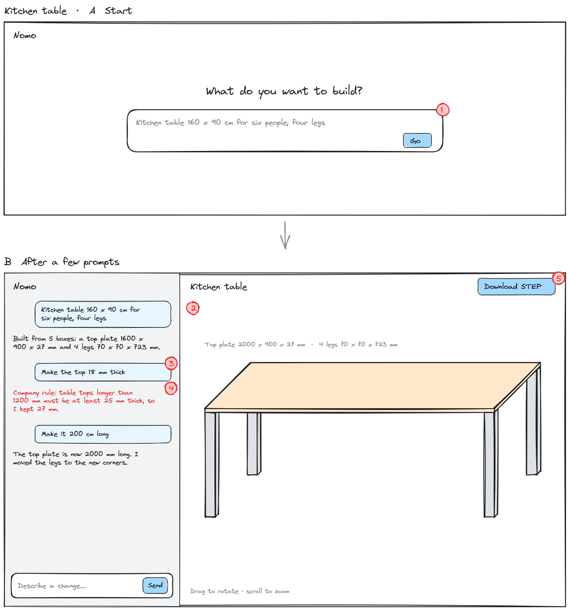

# Nomo: AI-generated CAD models that follow company standards

Patrick Demichiel - 16 October 2026

*Nomo*: from Greek *nómos*, "law".

## Users and their problem

Nomo is for engineering teams at manufacturing companies that design physical products.

AI tools can now generate CAD models from a text prompt. The results look plausible, but they don't fit the company that has to use them. The AI draws its own generic parts instead of the company's parts, standard parts and purchased components. It also doesn't know the company's design rules, such as minimum wall thicknesses, standard hole spacings or the sizes in stock. An engineer has to check and correct every model, and most of the time saved is lost again.

## How they handle it today

Most engineers still model by hand, often starting from an earlier design and carrying over its mistakes. Some companies use CAD configurators. These do follow the standards, but they are expensive to set up and can only produce what someone modelled in advance. Text-to-CAD tools such as MecAgent or Zoo are fast, but they know neither the company's parts nor its rules.

## Smallest useful version

A desktop web app with a chat on the left and the 3D model on the right. The AI never writes geometry itself. It picks approved templates, sets their parameters and positions them. A template is a parametric part, anything from a simple shape to one of the company's own parts, and it carries its own rules. Because the AI can only use templates, every model is made of company parts and follows company rules.

The first version has a single template, a box, and a few rules. We create these ourselves as a sample set, with AI help, so the team needs no CAD experience. A box is enough to build a simple table from a top plate and four legs:

1. The user types *"Kitchen table 160 × 90 cm for six people, four legs."*
2. The model appears in the 3D view.
3. *"Make the top 18 mm thick."* This breaks a company rule.
4. The AI keeps the rule and explains why: *"Company rule: table tops longer than 1200 mm must be at least 25 mm thick, so I kept 27 mm."* Requests that follow the rules update the same model, e.g. *"Make it 200 cm long"* lengthens the top and moves the legs to the new corners.
5. The user downloads the model as a STEP file and opens it in their own CAD system.

Later: more templates (cylinders, screws, company parts), version history, selecting parts in the 3D view and a parts list.

## Open questions and assumptions

- I assume a STEP file is good enough to start with. Native CAD formats can follow later.
- If no template fits a request, the app says so rather than inventing geometry. Will users accept that?
- Should the AI fall back to writing CAD code directly when no template fits? It would handle more requests, but those parts would not follow company standards.
- In the example, the AI repositions the legs itself. Should parts instead be linked by constraints, so the legs stay at the corners automatically?
- Do we need operations as well as parts, for example a drill that cuts a hole by subtracting a cylinder?
- Is Nomo actually better than generic AI?

## Sketch

Top: the start screen. Bottom: the screen after a few prompts. The numbers match the steps above.
